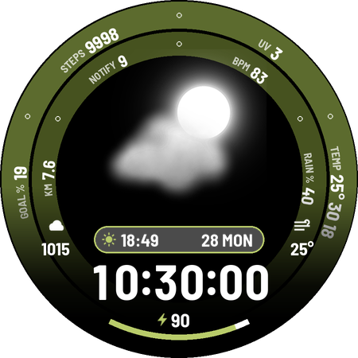

# Galaxy Watch 7 faces

Watch Face Format (WFF v2) watch faces for Wear OS 5+ (built for Galaxy Watch 7, 450×450).
Each face is its own module under `faces/`, and they share one build, signing and CI setup.

| Face | Preview |
|---|---|
| [Overlap](faces/overlap/): stacked two-tone digits, curved date, 5 configurable complications, 12 themes, heartbeat and rain animations |  |
| [Nimbus](faces/nimbus/): weather picture that follows the conditions, two configurable data rings, 3 complication slots, 12 themes, forecast on always-on |  |

## Get the APKs (phone only, no PC)

1. Every push to `main` builds all faces on GitHub Actions and publishes them to the
   **[latest release](../../releases/tag/latest)**. Open it on your phone and download the `.apk`.
2. Install it on the watch with an adb app from the Play Store, such as **Bugjaeger** or **Wear Installer 2**:
   - On the watch: **Settings > About watch > Software information**, tap **Software version** 5×.
   - **Settings > Developer options**: turn on **ADB debugging** and **Wireless debugging** (phone and watch on the same Wi-Fi).
   - **Wireless debugging > Pair new device**, enter the IP:port and pairing code in the app, then connect and install the APK.
3. Long-press the current face, swipe to the end, tap **+ Add watch face** and pick the new one.

All builds are signed with the same key, so a new build installs as an update over the old one.

## Repository layout

```
faces/<name>/
  face.properties          package, versionName, title  (the only per-face build settings)
  build.gradle.kts         one line, applies the Android plugin
  src/main/AndroidManifest.xml, res/raw/watchface.xml, res/...
  design/                  optional generator / preview scripts for that face
build.gradle.kts           shared SDK levels, signing, versionCode for every face
settings.gradle.kts        auto-includes every faces/* folder
tools/validate_wff.py      validates every face against the official WFF XSD
tools/build_without_gradle.sh   aapt2-only build, no Android Gradle Plugin
tools/new_face.py          scaffolds a new face that builds immediately
signing/sideload.keystore  shared sideload signing key (see Signing)
.github/workflows/build.yml     validate, build, publish releases
```

## Adding a face

```sh
python3 tools/new_face.py orbit "Orbit"     # creates faces/orbit with a starter clock
```

Then design `faces/orbit/src/main/res/raw/watchface.xml` and push. CI picks it up automatically.

## Building yourself (optional)

```sh
./gradlew assembleRelease                    # all faces (JDK 17 + Android SDK)
./gradlew :faces:overlap:assembleRelease     # one face
tools/build_without_gradle.sh [face ...]     # no Gradle: apt install aapt apksigner zipalign android-sdk-platform-23
python3 tools/validate_wff.py                # pip install xmlschema
```

## Battery rules every face here follows

- **No seconds. Animations are optional,** run at 15 fps or less, only in full mode, with an off switch.
- **Always-on mode at ≤ 15% lit pixels**, the Wear OS guideline. Use outlines or small dim elements, never big filled areas.
- **Complications hidden in always-on mode.** The data still updates, but nothing is drawn.
- **Pure black background.** OLED pixels that are black are off and use no power.
- **Few assets.** Small PNGs and one font per face keep memory low; WFF enforces a memory budget.

## Signing

`signing/sideload.keystore` (alias `debug`, password `android`) is committed on purpose. Every
build then has the same signature, so updates install over the old version. That is fine
for sideloading your own watch. **Do not publish to Google Play with it.** For Play, create a
private key and add the repo secrets `SIGNING_KEYSTORE_BASE64`, `SIGNING_STORE_PASSWORD`,
`SIGNING_KEY_ALIAS` and `SIGNING_KEY_PASSWORD`; CI uses them automatically when they exist.
Switching keys means uninstalling the old build once.

## Licenses

Code: Apache-2.0. Fonts keep their own licenses in `licenses/` (Fredoka: SIL OFL 1.1).
