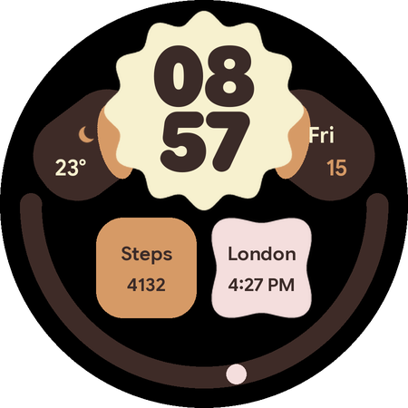
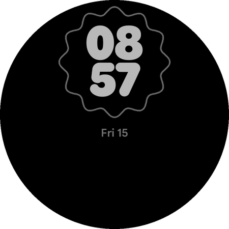
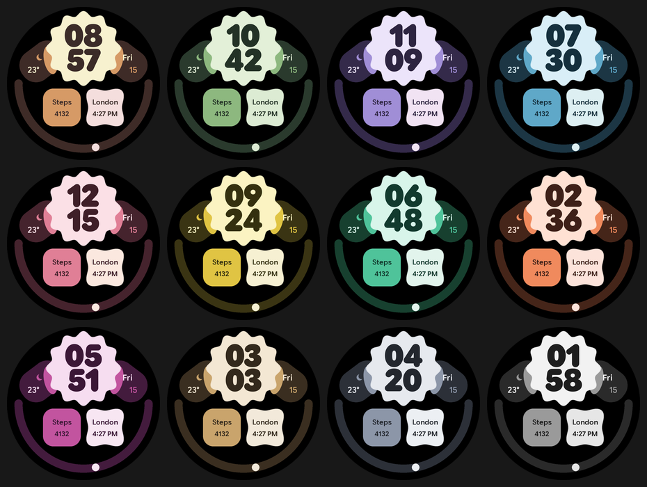

# Bloom

A soft, shape-driven digital face: hours stacked over minutes inside a scalloped clock shape,
weather and date in two side pods, two tiles below (a complication and a second time zone)
and a progress arc along the bottom. 12 color themes.

 

(Previews are rendered by `design/render_preview.py`, an approximation of the real renderer.)

## Customize (long-press the face > Customize)

| Setting | Options | Default |
|---|---|---|
| Color theme | Mocha, Sage, Lavender, Ocean, Rose, Citrus, Mint, Coral, Berry, Sand, Slate, Mono | Mocha |
| Second time zone | Off, London, Paris, Istanbul, Riyadh, Dubai, Karachi, India, Singapore, Hong Kong, Tokyo, Sydney, New York, Chicago, Los Angeles, São Paulo, UTC | London |
| Left pod (complication) | short text, ranged value, goal, icon, small image. **Empty = weather** (icon + temperature) | Empty |
| Right pod (complication) | same. **Empty = date** (weekday + day) | Empty |
| Bottom left tile (complication) | same | Steps |
| Bottom right tile (complication) | same. **Empty = second time zone** | Empty |
| Bottom arc (complication) | ranged value or goal, shown as a dot along the arc | Watch battery |

**How the dual clock works.** The bottom right tile is a normal complication slot. While it is
empty it shows the city and time from the *Second time zone* setting (12 or 24 h, following the
watch). Pick *Off* to hide it, or put any complication in the slot to replace it. A complication
slot can't be switched on and off by a setting in Watch Face Format, which is why the clock lives
in the slot's empty state instead of a separate toggle.

The time zone list is fixed (WFF has no free-text setting). Ask for any other city and it's one
line in `design/gen_watchface.py`. If you need an arbitrary city, Samsung's World clock
complication in that tile works too.

## Always-on display

Grey hours and minutes inside a thin outline of the clock shape, plus the weekday and date.
About 8% of the dial is lit (measured on the preview render). Pods, tiles, arc and all
complications are off in always-on.

## Battery notes

- No seconds and no animations. The face only redraws once a minute plus when complication data changes.
- Pure black background; the shapes are three small tinted PNG masks and plain draw shapes.
- One font family, two small subsets: the digits font holds only 0-9 (5 KB).

## Font

Google Sans Flex, the same family as the reference screenshot: the Rounded Black instance for
the digits and SemiBold for text. It's on Google Fonts under the SIL Open Font License 1.1
(`licenses/GoogleSansFlex-OFL.txt`), so it can be bundled and subset.

## Files

- `design/gen_watchface.py` writes `src/main/res/raw/watchface.xml` (don't edit the XML by hand).
- `design/make_assets.py` draws the shape masks and weather icons; `make_assets.py fonts` re-downloads and subsets the fonts.
- `design/render_preview.py` draws the preview, launcher icon and the images above.
- Shared helpers: `tools/wff.py` (XML), `tools/preview.py` (preview rendering), `tools/weather_icons.py`.
