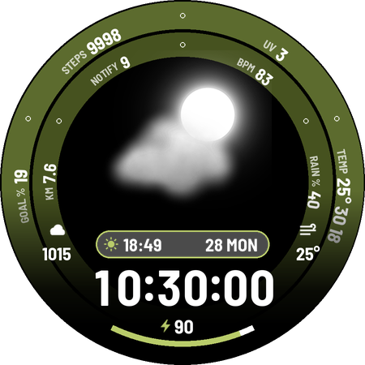
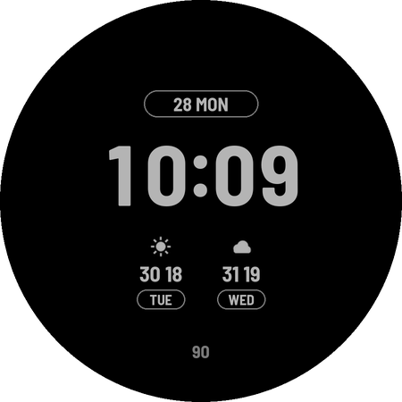
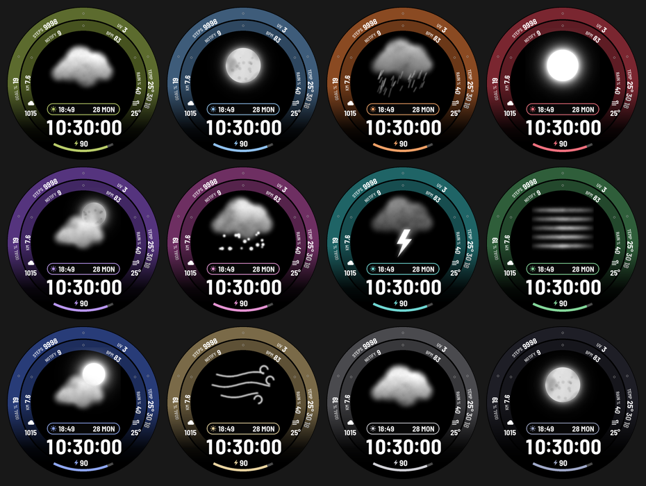

# Nimbus

A weather-first digital face: a large weather picture in the middle that follows the current
conditions, two curved rings of data around it, a date pill, big HH:MM(:SS), and a battery arc.
Uses the watch's built-in weather (Watch Face Format v2), so no weather app is needed beyond
the one already on the Galaxy Watch.

 

(Previews are rendered by `design/render_preview.py`, an approximation of the real renderer.)

## Customize (long-press the face > Customize)

| Setting | Options | Default |
|---|---|---|
| Color theme | Olive, Steel, Rust, Crimson, Violet, Plum, Teal, Forest, Navy, Sand, Graphite, Midnight | Olive |
| Show seconds | on / off (off shows bigger HH:MM) | off |
| Rain and snow motion | on / off (falling drops over the picture, only while it rains or snows) | off |
| Outer ring: left, top left, top right, right | Nothing, Steps, Step goal %, Distance km, Distance mi, Unread notifications, Heart rate, UV index, Temperature now/high/low, Today high and low, Chance of rain, Battery | Step goal %, Steps, UV, Temperature |
| Inner ring: left, top left, top right, right | same list | Distance km, Notifications, Heart rate, Chance of rain |
| Left slot (complication) | short text, ranged value, goal, icon, small image | Next event |
| Right slot (complication) | same | World clock |
| Date pill slot (complication) | short text, ranged value, icon | Sunrise / sunset |

On a Galaxy Watch, good picks for the left and right slots are Samsung's Barometer and
Weather "feels like" complications, which match the original idea.

**Why the rings are settings and not complications:** each ring value is a curved text item.
A complication slot is a tap target with a rectangle or oval hit area; eight of them packed into
two thin curved bands would overlap and steal each other's taps. So the rings pick from the
watch's own data (anything Watch Face Format exposes), and the three real slots take any
complication from any app.

**Distance is an estimate.** Watch Face Format has no distance data, so km/mi are
steps x 0.75 m. Samsung Health's figure uses your height and stride, so it will differ by
a few percent. Put Samsung's own distance complication in a side slot if you need the exact number.

## Always-on display

Dimmed grey time, date, and a two-item forecast. From 07:00 to 23:59 it shows tomorrow and the
day after (icon, high/low, weekday); from 00:00 to 06:59 it shows +3 h and +6 h hourly.
About 7% of the dial is lit (measured on the preview render). The rings, weather picture and
complications are off in always-on.

## Battery notes

- Seconds are off by default. With seconds on, the face redraws every second while the screen
  is awake; it never shows seconds in always-on, so the extra cost only applies while you look at it.
- Rain/snow motion is off by default. It runs at 12 fps only while the screen is awake and only
  during rain or snow, but any animation keeps the GPU busy, so leave it off if battery matters most.
- The weather picture is a static image. WFF has no video or GIF playback, only simple
  property animations, so smooth animated clouds like some commercial faces aren't possible
  in a code-free WFF face at a sensible battery cost.

## Files

- `design/gen_watchface.py` writes `src/main/res/raw/watchface.xml` (don't edit the XML by hand).
- `design/make_weather_art.py` draws the big weather pictures (`wxl_*.png`), all procedural.
- `design/make_icons.py` draws the bolt icon. The small forecast icons `wx_*.png` come from Overlap.
- `design/render_preview.py` draws the preview, launcher icon and the images above.
- Font: Barlow Semi Condensed Bold (SIL Open Font License, see `licenses/Barlow-OFL.txt`).
