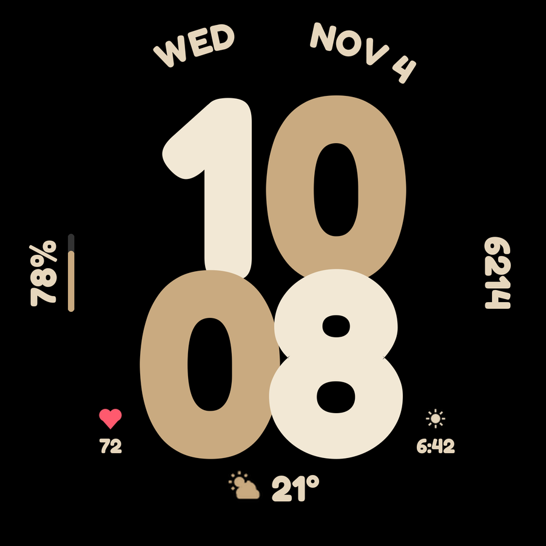
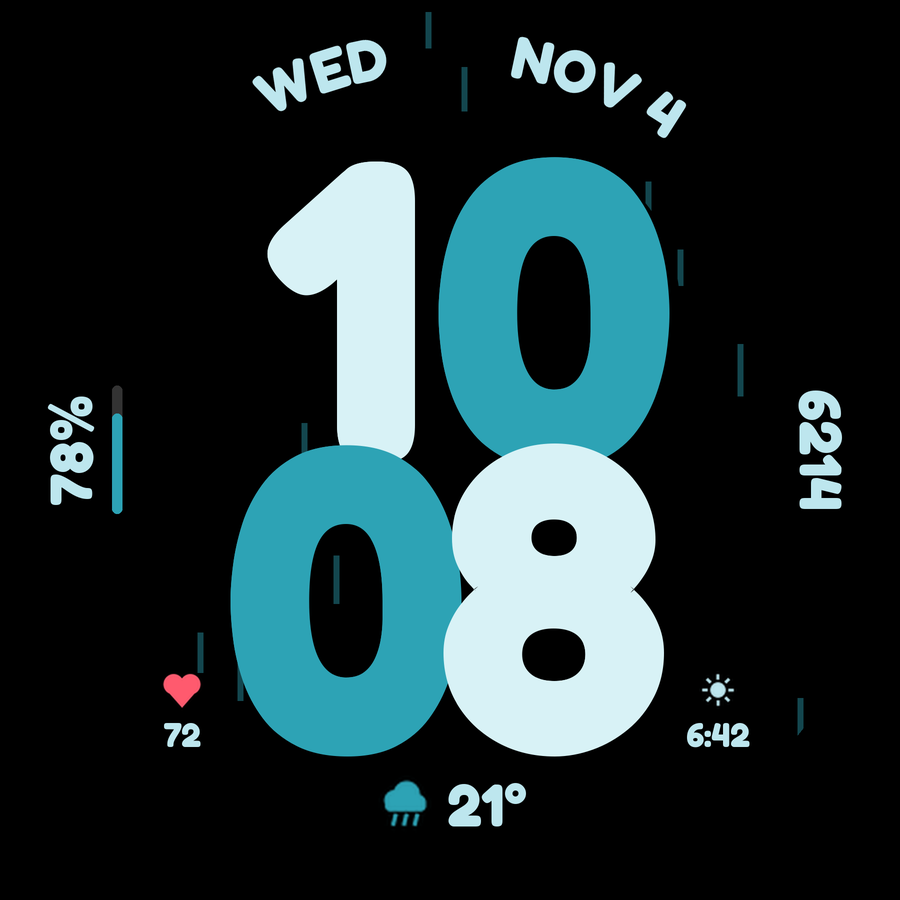
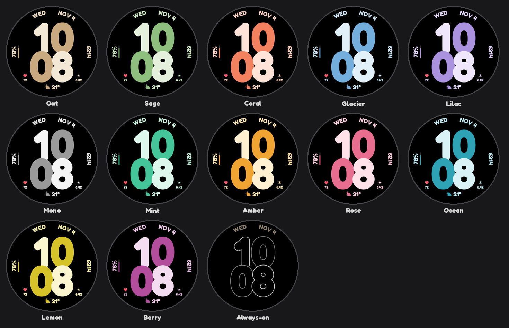

# Overlap

Stacked two-tone digits: hours on top, minutes below, a checkerboard of two theme colours
with a carved shadow where the digits overlap. The date curves along the top, and there are
three complication slots.

 



## Customize (long-press the face > Customize)

| Setting | Options | Default |
|---|---|---|
| Color theme | Oat, Sage, Coral, Glacier, Lilac, Mono, Mint, Amber, Rose, Ocean, Lemon, Berry | Oat |
| Show date | on / off | on |
| Heartbeat animation | on / off (beating heart in the bottom-left slot) | on |
| Rain animation | on / off (falling rain behind the digits, only while it is raining) | on |
| Show Low / Med / High on | No slot, or one of the five slots | No slot |
| Left slot (vertical) | ranged value, goal, short text, icon, small image | Watch battery |
| Right slot (vertical) | same | Step count |
| Bottom slot | ranged value, goal, short text, long text, icon | Empty, which shows weather (icon + temperature) |
| Bottom-left slot | ranged value, goal, short text, icon, small image | Empty, which shows heart rate |
| Bottom-right slot | same | Sunrise / sunset |

**Low / Med / High:** for a slot you pick, values on a min–max scale (stress, for example) are shown as
words: HIGH at 70% of the range or more, MED at 35% or more, LOW below that. Every slot prefers
ranged values, so providers such as stress and battery send a number this can work with.

The date is split around 12 o'clock so the watch's charging and status icons don't cover it.
12/24-hour follows the watch setting.

## Battery

The two animations are the only things that redraw more than once a minute. Both run at 15 fps
only while the screen is in full mode, and never in always-on mode. Rain only runs while the
weather says it is raining. Turn them off in Customize for the longest battery life.

## Always-on mode

Always-on mode switches to outline-only digits (pre-rendered bitmaps, `amb_*.png`): a black fill
with a 3 px grey stroke. The black fill still hides the digit behind it, so the stacked look stays.
Complications are hidden, and the date dims to about 60%.

| Mock-up measurement | Lit pixels | Average brightness |
|---|---|---|
| Filled dim digits (v1.0) | 29.5% | 9.2% |
| Outline digits (v1.1) | about 7% | about 3% |

## Editing the design

Geometry, colours and themes live in `design/gen_watchface.py`. From `faces/overlap`:

```sh
python3 design/make_ambient_digits.py                            # only if size/stroke/tones changed (needs Pillow)
python3 design/make_icons.py                                     # only if icons changed (needs Pillow)
python3 design/gen_watchface.py > src/main/res/raw/watchface.xml
python3 design/render_preview.py src/main/res/font/fredoka_bold.ttf docs/preview.png 0 0 900
```

CI fails if `watchface.xml` doesn't match the generator output.

## Status

The XML passes the official WFF v2 schema check. The preview images are a Pillow mock-up, not
captures from a real watch, so the digits and the date may sit a few pixels differently on the watch.
